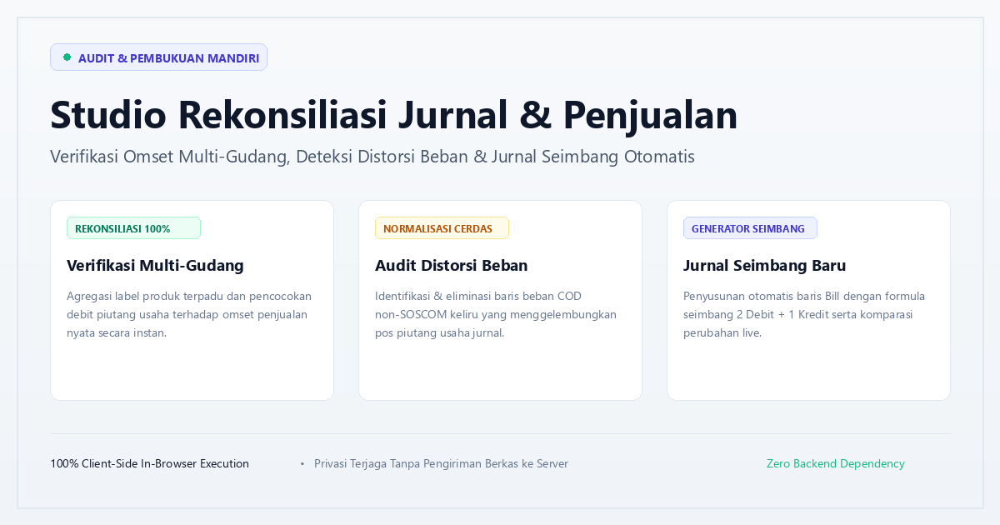

# Studio Rekonsiliasi Jurnal & Penjualan

> Sistem verifikasi, audit, dan rekonsiliasi transaksi penjualan multi-gudang terhadap jurnal finance pembukuan berbasis peramban mandiri (100% Client-Side).



## 📌 Fitur Utama

1. **Rekonsiliasi Agregasi Multi-Gudang (Two-Tier Warehouse Breakdown)**
   - Menyelaraskan transaksi penjualan lintas gudang (Jakarta, Surabaya, Gudang Utama) ke satu baris label transaksi terpadu.
   - Perbandingan presisi antara omset penjualan nyata (Sales Report) dengan akun Piutang Usaha di Jurnal Finance.

2. **Diagnostik Pembukuan & Deteksi Akar Selisih**
   - Pemisahan transparan antara debit faktur murni (`Invoices`) dengan debit beban (`Bill`).
   - Deteksi otomatis baris Bill yang keliru mendebit akun Piutang Usaha.

3. **Normalisasi & Eliminasi Beban COD Non-SOSCOM**
   - Menyingkirkan beban ganda COD non-SOSCOM secara otomatis sesuai aturan bisnis pembukuan.

4. **Generator Jurnal Seimbang 100% (2 Debit + 1 Kredit)**
   - Merekonstruksi struktur baris Bill otomatis dengan formula:
     $$\text{Dr1 (Ongkir Bersih)} + \text{Dr2 (Biaya Promo)} = \text{Cr (Utang Ongkir)}$$
   - Dilengkapi tab komparasi live sebelum dan sesudah penyeimbangan.

5. **Privasi & Keamanan Maksimal (Zero Backend / Zero Database)**
   - Berjalan 100% di browser pengguna menggunakan pustaka SheetJS offline.
   - Tidak ada data yang dikirim atau disimpan di server luar.

---

## 🚀 Akses Online (GitHub Pages)

Aplikasi dapat langsung diakses secara publik melalui GitHub Pages:
👉 **[https://agungwisnu-collab.github.io/jurnal-sales/](https://agungwisnu-collab.github.io/jurnal-sales/)**

---

## 💻 Penggunaan Lokal

Cukup klon repositori dan buka `index.html` di browser apa pun:

```bash
git clone https://github.com/agungwisnu-collab/jurnal-sales.git
cd jurnal-sales
# Buka langsung file index.html di browser favorit Anda
# Atau jalankan web server lokal sederhana:
python -m http.server 8085
```

---

## 📄 Lisensi
MIT License.
